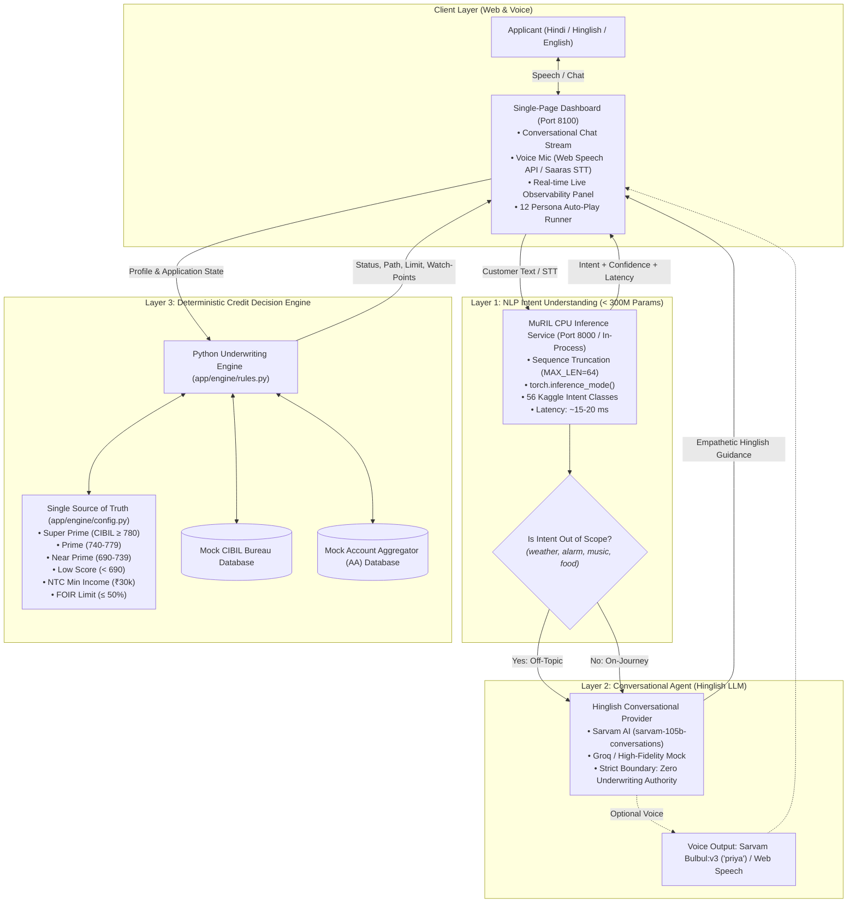

# Technical Architecture & System Design Document
## Hinglish Card Assistant — Multilingual Credit Card Onboarding System

---

## 1. Executive Summary & Vision

The **Hinglish Card Assistant** is a production-grade, conversational credit card onboarding platform specifically engineered for Indian consumers communicating in **Hindi, Romanized Hinglish (code-mixed), and English**.

### Core Engineering Philosophy
Most conversational AI systems in financial services suffer from two fatal design flaws:
1. **Hallucination in Underwriting**: Allowing generative LLMs to make credit or limit decisions, which violates banking regulations and introduces non-deterministic risk.
2. **Poor Language Grounding**: Off-the-shelf English LLMs struggle with code-mixed Hindi-English syntax (e.g. *"bhai mera cibil check kar lo"*, *"limit kitni milegi"*).

**Our Architectural Solution**:
We enforce a strict **three-layer decoupled architecture**:
- **Layer 1 (Understanding)**: A dedicated, fine-tuned multilingual transformer model (**MuRIL**, $< 300\text{M}$ parameters) running on CPU for real-time intent classification ($< 20\text{ ms}$).
- **Layer 2 (Conversation & Voice)**: A natural, WhatsApp-style Hinglish conversational agent that guides users, gathers missing fields, and handles voice STT/TTS without ever touching credit risk logic.
- **Layer 3 (Decision Engine)**: A 100% deterministic, audit-compliant Python rules engine evaluating credit scores, Fixed Obligation to Income Ratio (FOIR), and Account Aggregator (AA) data.

---

## 2. High-Level Architecture Diagram



---

## 3. Deep Dive into the Three Architectural Layers

### Layer 1: Understanding (Custom Hinglish NLP Model)
- **Base Architecture**: `google/muril-base-cased` (236.6 Million parameters, safely under the 300M threshold).
- **Multilingual Tokenizer**: Vocabulary of 197,285 tokens covering 17 Indian languages and Latin transliterations.
- **CPU Optimization**:
  - `torch.inference_mode()` disables autograd overhead completely.
  - Multi-threaded CPU execution tuned via `torch.set_num_threads()`.
  - Sentence length clamped to `MAX_LEN=64` (tailored for short voice assistant queries).
  - Average inference latency: **$15\text{ ms} - 22\text{ ms}$** on standard modern CPU cores.
- **Intent Taxonomy**: 56 intents from Anveshan Data Sprint 2.
- **Out-of-Scope Steering Mechanism**:
  If a customer deviates into non-banking queries (e.g. *"kal subah 7 baje alarm lagao"* $\to$ `alarm_podcast_coffee_game`, *"aaj mausam kaisa hai"* $\to$ `weather_query`, *"arijit ke gaane chalao"* $\to$ `music_play`), the model catches it in $<20\text{ ms}$. The LLM acknowledges it in Hinglish, politely steers the user back to the application, and lights up an alert on the dashboard.

### Layer 2: Conversation & Voice (Hinglish Grounded)
- **Model Grounding**: Integrated with **Sarvam AI** (`sarvam-105b-conversations`), **Groq** (`llama-3.3-70b-versatile`), and an intelligent zero-key **Mock Provider**.
- **System Prompt & Style Rules**:
  - Speaks natural, WhatsApp-style Romanized Hinglish.
  - Retains multi-turn conversation memory.
  - Dynamically explains alternatives (e.g. comparing Infinia, Regalia Gold for travel/lounge, and Millennia for shopping cashback).
- **Voice Pipeline**:
  - **Speech-to-Text (STT)**: Native browser Web Speech API (`SpeechRecognition` in `hi-IN`) for zero-latency instant input, with server-side Sarvam `saaras:v3` fallback.
  - **Text-to-Speech (TTS)**: Sarvam AI `bulbul:v3` with speaker `priya` (or native browser `speechSynthesis`).

### Layer 3: Deterministic Credit Decision Engine
All underwriting decisions are executed by pure Python functions with **zero LLM involvement**:
- **Bureau Bands**:
  - **Super Prime (CIBIL $\ge 780$)**: Indicative soft pull first; income proof waived; eKYC deferred to final step. Limit: ₹3,50,000 (Infinia Metal).
  - **Prime (CIBIL $740-779$)**: Income derived from bureau records (₹1,10,000); skips salary slip; light address check if owned home + married. Limit: 2.5× income (Regalia Gold).
  - **Near Prime (CIBIL $690-739$)**: Stated income + existing EMIs checked against **FOIR $\le 50\%$** (with 5% notional card EMI). Limit: 1.8× income (Millennia Select).
  - **Low Score (CIBIL $< 690$)**: Income question waived; routed to secured credit-builder card (Step-Up Secured, ₹25,000 limit).
- **New-To-Credit (NTC - Bureau Score = None)**:
  - Income $\ge \text{₹}30,000$ backed by 3 payslips $\to$ Approved for Near Prime.
  - Account Aggregator (AA) verified income $\ge \text{₹}30,000$ $\to$ Verified AA figure directly sizes limit.
  - Overstated Income ($> 25\%$ discrepancy between stated and AA) $\to$ AA figure sizes limit; if $< \text{₹}30\text{k}$, offered secured card.
  - Low Income ($< \text{₹}30,000$) $\to$ Offered FD-backed secured credit-builder card.
- **Special Tracks**:
  - **Student Track**: 0 bureau pull, 0 income questions asked; offered Campus FD-Backed Credit Builder (₹20,000 limit).
  - **ETB Pre-Approved Track**: Existing bank customer; pre-approved offer on file; 0 bureau pull, 0 new documents; one-tap issuance.

---

## 4. Acceptance Personas Matrix (12 Scenarios)

All 12 personas from OmniSpark's `legacy/demo.py` are codified in `app/personas.py` and validated by automated tests:

| # | Persona ID | Customer Name | Segment | Key Underwriting Signals | Expected Status | Expected Path | Credit Limit |
|---|---|---|---|---|---|---|---|
| 1 | `ntb_super_prime` | Vikram Sethi | New to bank | CIBIL 810, bureau income ₹1,40,000 | `APPROVE` | `super_prime` | ₹3,50,000 |
| 2 | `ntb_prime` | Priya Nair | New to bank | CIBIL 752, bureau income ₹1,10,000, owns home, 2 kids | `APPROVE` | `prime` | ₹2,75,000 |
| 3 | `ntb_near_prime` | Arjun Mehta | New to bank | CIBIL 705, stated ₹65k, EMIs ₹8k, FOIR within 50% | `APPROVE` | `near_prime` | ₹1,17,000 |
| 4 | `ntb_pg_stable` | Aarav Menon | New to bank | CIBIL 712, PG 1 yr, employer tenure 3 yrs | `APPROVE` | `near_prime` | ₹1,04,400 |
| 5 | `ntb_pg_new_job` | Nisha Kapoor | New to bank | CIBIL 710, PG resident, job 5 mos, AA verified ₹55k | `APPROVE` | `near_prime` | ₹99,000 |
| 6 | `ntc_unsecured` | Meera Iyer | New to credit | Zero credit history, ₹85k salary, 3 payslips | `APPROVE` | `near_prime` | ₹1,53,000 |
| 7 | `ntc_aa` | Tanvi Shah | New to credit | Zero credit history, AA verified ₹68k | `APPROVE` | `near_prime` | ₹1,22,400 |
| 8 | `ntc_overstated` | Imran Qureshi | New to credit | Claims ₹85k, but AA verified ₹24k (< ₹30k cutoff) | `SECURED_OFFER` | `secured` | ₹25,000 |
| 9 | `ntc_secured` | Kavya Rao | New to credit | Zero credit history, ₹22k monthly income (< ₹30k) | `SECURED_OFFER` | `secured` | ₹25,000 |
| 10 | `ntb_low_score` | Rohan Das | New to bank | CIBIL 640 (< 690 threshold), income waived | `SECURED_OFFER` | `secured` | ₹25,000 |
| 11 | `student` | Ananya Gupta | New to credit | Age 20, student, zero income, zero bureau pull | `SECURED_OFFER` | `student` | ₹20,000 |
| 12 | `etb_preapproved` | Asha Rao | Existing customer | 6-yr customer, pre-approved on file, zero new docs | `APPROVE` | `etb_preapproved` | ₹2,50,000 |

---

## 5. Phase 2: Domain Adaptation (Banking Intent Classifier)

The repository provides the complete tooling to adapt the model from general voice intents to dedicated banking intents:
1. **Dataset Generator (`training/make_banking_dataset.py`)**:
   - Defines 15 banking intents (`apply_card`, `check_eligibility`, `give_income`, `give_pan`, `give_dob`, `ask_documents`, `ask_fees`, `compare_cards`, `consent_yes`, `consent_no`, `ask_status`, `talk_to_human`, `greeting`, `ask_card_benefits`, `out_of_scope`).
   - Generates diverse utterances across Devanagari Hindi, Romanized Hinglish, and English using LLM expansion.
   - Applies `common.py`'s `augment()` (Devanagari romanization, spelling permutations, and chatification).
2. **Fine-Tuning Notebook (`training/train_banking.ipynb`)**:
   - Trains `google/muril-base-cased` using cosine warmup schedule and AdamW on GPU.
   - Exports `muril_banking.zip`.
3. **Zero-Code Deployment**:
   - Drop the unzipped model into `model_service/muril_banking/` and set `INTENT_MODEL_DIR=./model_service/muril_banking` in `.env` to deploy instantly.

---

## 6. Execution & Deployment Modes

### Mode A: Zero-Dependency Standard Library Runner
Runs immediately with **zero pip installs**:
```powershell
python app/server.py
```
*(Runs pure Python HTTP server on port 8100 serving static frontend, API endpoints, and decision engine)*.

### Mode B: Production FastAPI + Uvicorn
```powershell
pip install -r requirements.txt
python -m uvicorn app.main:app --host 127.0.0.1 --port 8100 --reload
```

### Automated Windows Launcher
```powershell
.\run_all.ps1
```
*(Automatically checks environment, loads `.env`, starts the server, and launches your default browser to `http://localhost:8100`)*.
