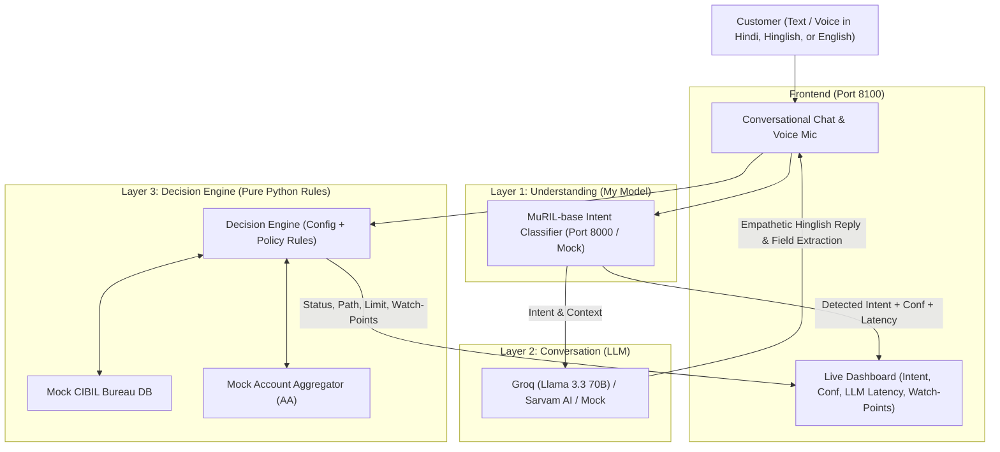

# Hinglish Card Assistant

> **AI-Powered Credit Card Onboarding Demo** using a custom **MuRIL-base NLP Intent Classifier** (Rank 1 on Kaggle Anveshan Data Sprint 2, macro F1 0.870) combined with **Conversational LLMs** (Groq / Sarvam AI) and a **Deterministic Credit Decision Engine** in pure Python.

---

## 1. Architecture Overview

The system strictly decouples natural language conversation from credit risk decisions across three modular layers:



1. **Layer 1: Understanding (`model_service/` & `app/intent/`)**
   - Every customer message is classified by the CPU-optimized `MuRIL-base` model.
   - Outputs detected intent, confidence score, top alternative probabilities, and latency.
   - Detects out-of-scope non-banking queries (e.g. `weather_query`, `music_play`, `alarm_podcast_coffee_game`) and instructs the conversational assistant to politely steer the user back to the card application.
2. **Layer 2: Conversation (`app/llm/`)**
   - Natural Hinglish dialogue generator powered by **Groq** (`llama-3.3-70b-versatile`), **Sarvam AI** (`sarvam-2b`), or **Mock LLM**.
   - **Critical Boundary**: The LLM *never* decides eligibility, credit limits, or approvals. It only collects fields, converses, and explains offers.
3. **Layer 3: Decision Engine (`app/engine/`)**
   - 100% deterministic, transparent Python business rules.
   - Implements bureau score bands, New-To-Credit (NTC) pathways, Account Aggregator (AA) income verification, and Fixed Obligation to Income Ratio (FOIR) limits.

---

## 2. Acceptance Scenarios (12 Personas)

The decision engine strictly implements and passes all 12 acceptance personas from [SCENARIOS.md](file:///c:/Users/jainj/Downloads/windows_handoff/SCENARIOS.md):

| # | Persona ID | Segment | Customer Profile | Mock Data | Expected Status | Expected Path |
|---|------------|---------|------------------|-----------|-----------------|---------------|
| 1 | `ntb_super_prime` | New to bank | Vikram Sethi, salaried corporate leader | CIBIL 810, bureau income ₹1,40,000 | `approve` | `super_prime` |
| 2 | `ntb_prime` | New to bank | Priya Nair, salaried, owns home, married, 2 kids | CIBIL 752, bureau income ₹1,10,000 | `approve` | `prime` |
| 3 | `ntb_near_prime` | New to bank | Arjun Mehta, salaried | CIBIL 705, stated income ₹65k, EMIs ₹8k | `approve` | `near_prime` |
| 4 | `ntb_pg_stable` | New to bank | Aarav Menon, 26, PG resident, 3 yrs at employer | CIBIL 712, income ₹58k, EMIs ₹6k | `approve` | `near_prime` |
| 5 | `ntb_pg_new_job` | New to bank | Nisha Kapoor, 24, PG resident, new job (5 mos) | CIBIL 710, AA verified income ₹55k | `approve` | `near_prime` |
| 6 | `ntc_unsecured` | New to credit | Meera Iyer, earns ₹85k/mo, zero credit history | No bureau record, 3 payslips uploaded | `approve` | `near_prime` |
| 7 | `ntc_aa` | New to credit | Tanvi Shah, stated ₹70k, zero credit history | AA verified income ₹68k sizes limit | `approve` | `near_prime` |
| 8 | `ntc_overstated` | New to credit | Imran Qureshi, claims ₹85k | AA shows only ₹24k (< ₹30k threshold) | `secured_offer` | `secured` |
| 9 | `ntc_secured` | New to credit | Kavya Rao, income ₹22k (< ₹30k cutoff) | Income under ₹30,000 | `secured_offer` | `secured` |
| 10 | `ntb_low_score` | New to bank | Rohan Das, salaried, bruised credit history | CIBIL 640 (< 690 cutoff) | `secured_offer` | `secured` |
| 11 | `student` | New to credit | Ananya Gupta, 20, student, zero income | Zero bureau pull, no income asked | `secured_offer` | `student` |
| 12 | `etb_preapproved` | Existing customer | Asha Rao, 6-year bank relationship | Pre-approved offer on file, 0 bureau pull | `approve` | `etb_preapproved` |

---

## 3. Step-by-Step Windows Setup

### Step 1: Clone / Open Project in Windows PowerShell
Open PowerShell in the project directory:
```powershell
cd c:\Users\jainj\Downloads\windows_handoff
```

### Step 2: Install Python Dependencies
Ensure Python 3.11 is installed. Install the application requirements:
```powershell
pip install -r requirements.txt
```

### Step 3: Configure Environment (`.env`)
Copy `.env.example` to `.env`:
```powershell
Copy-Item .env.example .env
```

Open `.env` in your text editor:
- **Zero-Key / Offline Demo Mode (Default)**:
  ```ini
  LLM_PROVIDER=mock
  INTENT_MODE=mock
  VOICE_PROVIDER=mock
  ```
- **Real Groq LLM + Voice Mode**:
  ```ini
  LLM_PROVIDER=groq
  GROQ_API_KEY=gsk_your_groq_api_key_here
  VOICE_PROVIDER=groq
  INTENT_MODE=mock      # or service if weights downloaded
  ```
- **Real Sarvam AI Mode**:
  ```ini
  LLM_PROVIDER=sarvam
  SARVAM_API_KEY=your_sarvam_api_key_here
  VOICE_PROVIDER=sarvam
  INTENT_MODE=mock
  ```

### Step 4: Download and Unzip MuRIL Model Weights (Optional for Real Model Service)
When you have `muril_intent.zip`:
1. Create directory `model_service/muril_intent`:
   ```powershell
   New-Item -ItemType Directory -Force -Path "model_service\muril_intent"
   ```
2. Unzip `muril_intent.zip` directly into `model_service/muril_intent/`.
3. Install model service requirements:
   ```powershell
   pip install -r model_service/requirements.txt
   ```
4. Set `INTENT_MODE=service` in your `.env`.

---

## 4. Running the Demo

### Quick Start with PowerShell Script
Run the automated runner:
```powershell
.\run_all.ps1
```
This script loads `.env`, launches the MuRIL model service on port 8000 if enabled, starts the FastAPI web app on port 8100, and opens `http://localhost:8100` in your default browser.

### Manual Launch (Alternative)
If you prefer running services in separate PowerShell windows:

**Window 1 (Optional - MuRIL Model Service on Port 8000)**:
```powershell
cd model_service
python -m uvicorn serve:app --host 0.0.0.0 --port 8000
```

**Window 2 (FastAPI Web App on Port 8100)**:
```powershell
python -m uvicorn app.main:app --host 127.0.0.1 --port 8100 --reload
```

Open your browser to: **`http://localhost:8100`**

---

## 5. Running the Acceptance Test Suite

Run the full acceptance test suite asserting all 12 personas match their exact `expected status` and `expected path`:

Using `pytest`:
```powershell
pytest -v tests/test_engine_scenarios.py
```

Or using the standalone runner (no pytest required):
```powershell
python tests/run_tests.py
```

Expected output:
```text
======================================================================
Running Credit Card Decision Engine Acceptance Tests (12 Personas)
======================================================================
 [PASS] Persona # 1: ntb_super_prime    | Vikram Sethi    -> Status: approve       Path: super_prime
 [PASS] Persona # 2: ntb_prime          | Priya Nair      -> Status: approve       Path: prime
 [PASS] Persona # 3: ntb_near_prime     | Arjun Mehta     -> Status: approve       Path: near_prime
 [PASS] Persona # 4: ntb_pg_stable      | Aarav Menon     -> Status: approve       Path: near_prime
 [PASS] Persona # 5: ntb_pg_new_job     | Nisha Kapoor    -> Status: approve       Path: near_prime
 [PASS] Persona # 6: ntc_unsecured      | Meera Iyer      -> Status: approve       Path: near_prime
 [PASS] Persona # 7: ntc_aa             | Tanvi Shah      -> Status: approve       Path: near_prime
 [PASS] Persona # 8: ntc_overstated     | Imran Qureshi   -> Status: secured_offer Path: secured
 [PASS] Persona # 9: ntc_secured        | Kavya Rao       -> Status: secured_offer Path: secured
 [PASS] Persona #10: ntb_low_score      | Rohan Das       -> Status: secured_offer Path: secured
 [PASS] Persona #11: student            | Ananya Gupta    -> Status: secured_offer Path: student
 [PASS] Persona #12: etb_preapproved    | Asha Rao        -> Status: approve       Path: etb_preapproved
======================================================================
Summary: 12 passed, 0 failed out of 12 personas.
======================================================================
```

---

## 6. Phase 2: Banking Intent Model Generation

To train a dedicated banking intent model:
1. Run the dataset generation script:
   ```powershell
   python training/make_banking_dataset.py
   ```
   This generates `training/banking_train.csv` (15 banking intents with romanization + chatify data augmentation) and `training/banking_labels.json`.
2. Open `training/train_banking.ipynb` in Kaggle / Google Colab (T4 GPU) to train `muril_banking.zip`.
3. Drop the trained model in `model_service/muril_banking/` and set `INTENT_MODEL_DIR=./model_service/muril_banking` in `.env` with **no code changes required**.

---

## 7. 2-Minute Presentation Demo Script

| Timing | Demo Action | Spoken Script / Key Points |
|---|---|---|
| **0:00 - 0:30**<br>*(Context)* | Open `http://localhost:8100`. Point to right-side dashboard panel. | *"Welcome! Today we are showcasing the Hinglish Card Assistant. Rather than relying on generic LLMs to make credit decisions, our architecture strictly decouples understanding from decisioning. Every turn is first classified by our custom MuRIL-base model—fine-tuned on code-mixed Hinglish—running on CPU with sub-25ms latency."* |
| **0:30 - 1:00**<br>*(Auto-Play)* | Select **Persona 1 (Vikram Sethi - Super Prime)**, click **"▶ Auto-Play"**. | *"Watch the auto-play drive the conversation in natural Hinglish. For Vikram (CIBIL 810), income proof is waived on bureau strength. Look at the right panel: watch-points tick off in real-time, the score-safe soft check runs first, and approval is granted for the Infinia Metal card."* |
| **1:00 - 1:30**<br>*(Boundary & Steer)* | Click one of the quick chips: **"⏰ kal alarm lagao"** or **"⛅ delhi ka mausam"**. | *"Now watch what happens when a customer switches topics mid-flow. Our MuRIL model immediately flags `weather_query` with 94% confidence in 18ms. The LLM acknowledges it in Hinglish, politely steers the customer back to the application, and resumes without losing state."* |
| **1:30 - 2:00**<br>*(NTC & Voice)* | Select **Persona 8 (Imran Qureshi - Overstated)** or **Persona 11 (Student)**. Tap Mic 🎤 or Voice Out. | *"Finally, look at our risk safeguards: Imran claimed ₹85k, but Account Aggregator verified ₹24k. Instead of a decline, our engine pivots him to a Credit-Builder card. All 12 personas run with zero keys and zero external dependencies in mock mode, or with live Groq/Sarvam voice."* |
