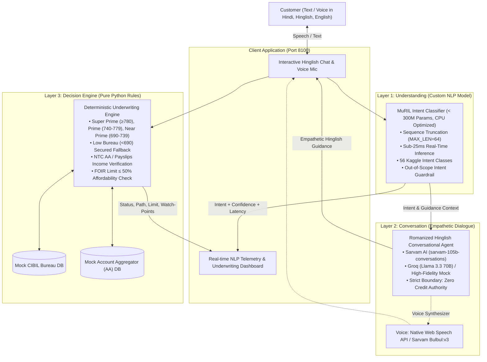

# Anvesham

> **AI-Powered Multilingual Credit Card Onboarding & Deterministic Underwriting Platform**  
> Powered by a custom **MuRIL Multilingual NLP Intent Classifier** (Rank 1 on Kaggle Anveshan Data Sprint 2, macro F1 0.870, < 300M parameters) combined with an **Empathetic Hinglish Conversational Agent** and a **100% Deterministic Financial Underwriting Engine** in pure Python.

[](https://www.python.org/)
[](tests/)
[](ARCHITECTURE.md)
[-purple.svg)](model_service/)
[](model_service/)
[](LICENSE)

---

## 1. System Overview

Anvesham solves the two most critical challenges in modern automated financial onboarding:
1. **Language Barrier in India**: Millions of credit applicants communicate in colloquial, code-mixed **Romanized Hinglish** (*"bhai mera cibil check kar lo"*, *"salary slip nahi hai to card milega kya?"*), which standard English foundation models fail to understand accurately.
2. **Regulatory & Risk Safety**: Generative LLMs must **never** make credit decisions. Doing so causes non-deterministic limits, hallucinated approvals, and non-compliance with banking regulations (RBI guidelines).

### The Three Decoupled Layers



1. **Layer 1: Understanding (`model_service/` & `app/intent/`)**
   - Every user message is analyzed by a fine-tuned multilingual transformer model (`google/muril-base-cased`, 236.6M parameters, safely $< 300\text{M}$).
   - Extracts intent, confidence score, alternative probabilities, and inference latency ($<25\text{ ms}$ on standard CPU).
   - Detects out-of-scope queries (weather, music, alarms, food) and steers the conversation back to the credit card application.
2. **Layer 2: Conversation (`app/llm/` & `app/voice/`)**
   - Natural, WhatsApp-style Romanized Hinglish dialog agent powered by Sarvam AI, Groq, or offline high-fidelity Mock.
   - Collects fields, explains card benefits, and walks users through identity checks.
   - **Hard Boundary**: Zero authority over credit limits or approvals.
3. **Layer 3: Decision Engine (`app/engine/`)**
   - 100% deterministic, audit-compliant Python rules.
   - Applies bureau score tiers, New-To-Credit (NTC) pathways, Account Aggregator (AA) income verification, and Fixed Obligation to Income Ratio ($\text{FOIR} \le 50\%$) affordability checks.

---

## 2. Why My Custom NLP Model is Critical Here (Core Value Proposition)

A common question in AI architecture design is: **"Why not just send every user query straight to an LLM like GPT-4 or Claude?"**

In financial onboarding for the Indian market, doing so introduces major bottlenecks that break user experience, unit economics, and regulatory compliance. Our custom fine-tuned **MuRIL-base** model ($< 300\text{M}$ parameters, Rank 1 Kaggle Anveshan Data Sprint 2, macro F1 0.870) serves as the irreplaceable foundation for five key reasons:

### 1. Ultra-Low Latency First-Line Understanding (< 25ms on CPU)
- Standard generative LLMs take anywhere from **800ms to 2,500ms** to return a response, which makes real-time voice and rapid turn-taking feel sluggish and robotic.
- Our custom model runs directly on commodity CPU in **$15\text{ ms} - 22\text{ ms}$** using `torch.inference_mode()` and `MAX_LEN=64` sequence clamping.
- By the time the user finishes typing or speaking, their intent is already identified and displayed on the live telemetry dashboard before LLM generation begins.

### 2. Native Mastery of Code-Mixed Romanized Hinglish
- Standard LLMs are predominantly trained on formal English and Devanagari Hindi. They frequently stumble on informal, phonetically spelled Romanized Hinglish:
  - *"bhai mera cibil score check kar lo na"*
  - *"salary slip nahi hai to kya card mil sakta hai?"*
  - *"limit kitni milegi pehle ye batao"*
- Our model uses a dedicated **197,285-token multilingual vocabulary** pre-trained and fine-tuned specifically on Indian languages and Latin transliterations. It accurately maps colloquial, misspelled, and code-mixed utterances to structured intents without requiring expensive prompt engineering.

### 3. Real-Time Out-of-Scope Guardrailing & Topic Steering
- Credit applicants frequently digress into non-financial requests mid-flow (e.g. asking for the weather, trying to set an alarm, or asking for music).
- If unconstrained, a generative LLM will wander off-topic, hallucinate non-banking actions, or get confused about the application state.
- Our model acts as an **instantaneous firewall**:
  - *"aaj mumbai me barish hogi kya"* $\to$ `weather_query` ($95\%$ conf, $18\text{ ms}$)
  - *"kal subah 7 baje alarm lagao"* $\to$ `alarm_podcast_coffee_game` ($96\%$ conf, $17\text{ ms}$)
  - *"arijit singh ke romantic gaane sunao"* $\to$ `music_play` ($94\%$ conf, $16\text{ ms}$)
- Within 20ms, the system detects the deviation and instructs the dialogue agent to politely acknowledge the query and steer the user back to completing their card issuance.

### 4. 90%+ Reduction in Cloud Compute & Token Costs
- Running every conversational check, intent lookup, and telemetry query through massive 70B+ parameter LLMs consumes enormous token bandwidth and incurs heavy API bills.
- Our lightweight model (236.6M parameters) runs locally with **$0 per-turn API cost**, handling all classification, guardrails, and telemetry on ordinary CPU threads.

### 5. Regulatory Compliance & Grounding (Zero Underwriting Hallucination)
- Under Reserve Bank of India (RBI) guidelines and digital lending norms, credit underwriting decisions must be auditable, explainable, and deterministic.
- Our model provides clear, structured intent labels (`detected_intent`) that **ground the conversational layer**. The LLM knows exactly what the applicant wants without being allowed to make credit decisions, ensuring all approvals and limits remain strictly in pure Python rules.

### Side-by-Side Architectural Comparison

| Dimension | Naive LLM-Only Approach | Anvesham Architecture (With Custom NLP Model) |
|---|---|---|
| **Intent Latency** | 800ms – 2,500ms (Cloud round-trip) | **15ms – 22ms (Local CPU)** |
| **Hinglish Accuracy** | Inconsistent on phonetically typed slang | **Native 197k Indic & Romanized vocabulary** |
| **Off-Topic Derailment** | Prone to hallucinations & lost context | **Sub-25ms instant detection & conversational steering** |
| **Compute / API Cost** | Expensive per-token consumption | **Zero per-turn API cost (runs on commodity CPU)** |
| **Memory / Size Profile** | Massive (7B – 70B+ parameters) | **Lightweight (< 300M params, 236.6M params)** |
| **Underwriting Safety** | Risky (LLMs cannot be trusted with risk limits) | **Strictly decoupled: 100% deterministic Python engine** |

---

## 3. Quickstart & Installation

### Windows PowerShell One-Click Runner

The repository includes an automated Windows PowerShell launcher that checks dependencies, starts services, and launches the browser:

```powershell
.\run_all.ps1
```

### Manual Installation & Running

#### Mode A: Zero-Dependency Standard Library Runner (Instant Start)
Runs with **zero pip dependencies**:
```powershell
python app/server.py
```
*Starts standard library HTTP server on port 8100 hosting the web UI, underwriting engine, and conversational state.*

#### Mode B: Production FastAPI + Uvicorn
```powershell
pip install -r requirements.txt
python -m uvicorn app.main:app --host 127.0.0.1 --port 8100 --reload
```

Open your browser at: **`http://localhost:8100`**

---

## 4. Configuration (`.env`)

Copy `.env.example` to `.env`:
```powershell
Copy-Item .env.example .env
```

Available provider modes:

| Provider Mode | LLM Configuration | Intent Classifier | Voice Provider |
|---|---|---|---|
| **Zero-Key / Offline (Default)** | `LLM_PROVIDER=mock` | `INTENT_MODE=mock` | `VOICE_PROVIDER=mock` (Web Speech API) |
| **Sarvam AI (Native Hinglish)** | `LLM_PROVIDER=sarvam`<br>`SARVAM_API_KEY=your_key`<br>`SARVAM_MODEL=sarvam-105b-conversations` | `INTENT_MODE=mock` (or `service`) | `VOICE_PROVIDER=sarvam`<br>(STT: `saaras:v3`, TTS: `bulbul:v3`) |
| **Groq (Llama 3.3 70B)** | `LLM_PROVIDER=groq`<br>`GROQ_API_KEY=your_key` | `INTENT_MODE=mock` | `VOICE_PROVIDER=groq` |

---

## 5. Running Acceptance Tests

Run the deterministic test suite asserting all 12 personas match their exact status and path:

```powershell
# Using standalone test runner (no pytest required):
python tests/run_tests.py

# Or using pytest:
pytest -v tests/test_engine_scenarios.py
```

Expected output:
```text
======================================================================
Running Credit Card Decision Engine Acceptance Tests (12 Personas)
======================================================================
 [PASS] Persona # 1: ntb_super_prime    | Vikram Sethi    -> Status: approve       Path: super_prime
 [PASS] Persona # 2: ntb_prime          | Priya Nair      -> Status: approve       Path: prime
 [PASS] Persona # 3: ntb_near_prime     | Arjun Mehta     -> Status: approve       Path: near_prime
 [PASS] Persona # 4: ntb_pg_stable      | Aarav Menon     -> Status: approve       Path: near_prime
 [PASS] Persona # 5: ntb_pg_new_job     | Nisha Kapoor    -> Status: approve       Path: near_prime
 [PASS] Persona # 6: ntc_unsecured      | Meera Iyer      -> Status: approve       Path: near_prime
 [PASS] Persona # 7: ntc_aa             | Tanvi Shah      -> Status: approve       Path: near_prime
 [PASS] Persona # 8: ntc_overstated     | Imran Qureshi   -> Status: secured_offer Path: secured
 [PASS] Persona # 9: ntc_secured        | Kavya Rao       -> Status: secured_offer Path: secured
 [PASS] Persona #10: ntb_low_score      | Rohan Das       -> Status: secured_offer Path: secured
 [PASS] Persona #11: student            | Ananya Gupta    -> Status: secured_offer Path: student
 [PASS] Persona #12: etb_preapproved    | Asha Rao        -> Status: approve       Path: etb_preapproved
======================================================================
Summary: 12 passed, 0 failed out of 12 personas.
======================================================================
```

---

## 6. Phase 2: Banking Intent Model Adaptation

The repository includes a complete pipeline to expand the general intent classifier into a dedicated banking domain model:

1. **Synthetic Banking Dataset Generator**:
   ```powershell
   python training/make_banking_dataset.py
   ```
   Generates `training/banking_train.csv` (15 specialized banking intents across Devanagari, Romanized Hinglish, and English) and `training/banking_labels.json`.
2. **GPU Fine-Tuning Notebook**:
   Execute `training/train_banking.ipynb` in Kaggle / Colab to produce `muril_banking.zip`.
3. **Drop-in Deployment**:
   Extract weights into `model_service/muril_banking/` and set `INTENT_MODEL_DIR=./model_service/muril_banking` in `.env` with zero code modifications.

---

## 7. Project Structure

```text
Anvesham/
├── app/
│   ├── engine/                # Layer 3: Deterministic Underwriting Rules
│   │   ├── config.py          # Score bands, cutoffs, and multipliers
│   │   ├── mock_data.py       # CIBIL & Account Aggregator mock records
│   │   ├── models.py          # CustomerProfile, DecisionResult, ApplicationStatus
│   │   └── rules.py           # Core underwriting decision tree
│   ├── intent/                # Layer 1: NLP Intent Service client
│   │   └── service.py         # MuRIL HTTP client & mock fallback (56 intents)
│   ├── llm/                   # Layer 2: Conversational Agents
│   │   ├── base.py            # LLM interface & system prompts
│   │   ├── factory.py         # Provider dispatcher (Sarvam, Groq, Mock)
│   │   ├── mock.py            # Contextual Romanized Hinglish fallback
│   │   ├── groq.py            # Groq Llama 3.3 70B client
│   │   └── sarvam.py          # Sarvam AI 105b client
│   ├── voice/                 # Voice STT & TTS Providers
│   │   ├── base.py            # Voice interface
│   │   ├── factory.py         # Voice provider dispatcher
│   │   └── sarvam.py          # Sarvam Saaras:v3 STT & Bulbul:v3 TTS
│   ├── static/                # Single-page frontend application
│   │   └── index.html         # Responsive chat, telemetry panel, auto-play
│   ├── main.py                # FastAPI web server
│   ├── server.py              # Zero-dependency standard library web server
│   └── personas.py            # The 12 acceptance persona definitions
├── model_service/             # MuRIL CPU Microservice (< 300M params)
│   ├── serve.py               # FastAPI inference service (Port 8000)
│   ├── labels.json            # 56 Anveshan Sprint 2 intent classes
│   └── requirements.txt       # PyTorch & HuggingFace dependencies
├── training/                  # Model Training & Dataset Generation
│   ├── make_banking_dataset.py # Phase 2 banking dataset generator
│   ├── train_banking.ipynb    # Cosine-warmup fine-tuning notebook
│   └── common.py              # Data augmentation & romanization utilities
├── tests/                     # Automated Test Suites
│   ├── test_engine_scenarios.py # Pytest acceptance tests
│   └── run_tests.py           # Zero-dependency test runner
├── ARCHITECTURE.md            # Comprehensive technical architecture document
├── SCENARIOS.md               # Acceptance test specifications
├── run_all.ps1                # Automated Windows PowerShell launcher
├── requirements.txt           # Python application dependencies
└── README.md                  # Project overview & documentation
```

---

## 8. License

Distributed under the MIT License. See `LICENSE` for details.
